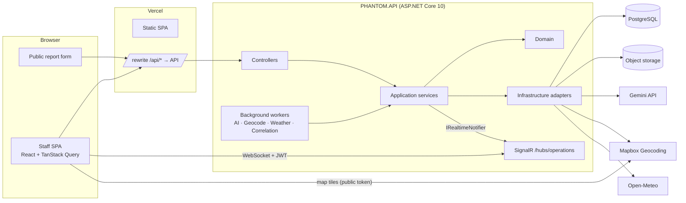
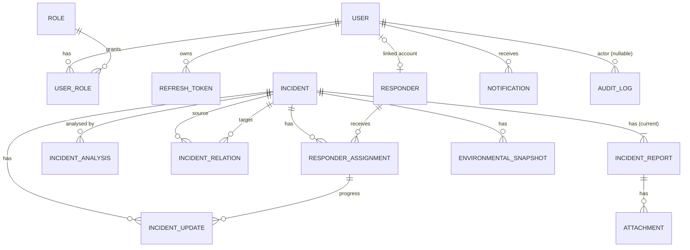

# Design Document — PHANTOM Platform

Status: **Draft for approval (Phase 1)**. Nothing in this document is implemented yet.

## 1. Overview

PHANTOM is a modular monolith (ASP.NET Core 10, PostgreSQL 17) with a React SPA (Vite, TypeScript).
Two independent Git repositories share one Kiro multi-root workspace:

| Repo | Path | Remote |
|---|---|---|
| Phantom_API | `/Users/yusufbashir/Documents/repos/backend/Phantom_API` | `github.com/yusbash03/Phantom_API` |
| Phantom_UI | `/Users/yusufbashir/Documents/repos/frontend/Phantom_UI` | `github.com/yusbash03/Phantom_UI` |

### Verified environment (2026-11-18)

| Tool | Version | Status |
|---|---|---|
| .NET SDK | 10.0.400 (LTS) | OK |
| dotnet-ef | 10.0.12 | OK |
| Node.js | 26.7.0 | OK (npm 11.19.0; no pnpm/yarn — use npm) |
| Docker | 29.7.2 | Running |
| PostgreSQL | Neon (managed, PostgreSQL 17) | Development database; Testcontainers for tests |
| Kiro | 1.4.215 (Kiro Crew installed) | OK |
| API keys | none found in environment | Gemini, Mapbox needed |

## 2. Architecture



### 2.1 Project layout (Phantom_API)

```
Phantom_API/
├── .kiro/                     # canonical specs, steering, agents, hooks
├── contracts/openapi.json     # generated at build, committed
├── docker-compose.yml         # PostgreSQL 17 for local dev
├── Directory.Build.props      # nullable, warnings-as-errors, analyzers
├── PHANTOM.sln
├── src/
│   ├── PHANTOM.Domain/        # Incidents/, Reports/, Responders/, Assignments/, Audit/, Common/
│   ├── PHANTOM.Application/   # one folder per module (see 2.2), Abstractions/ (ports)
│   ├── PHANTOM.Infrastructure/# Persistence/, Ai/, Geo/, Weather/, Storage/, Identity/, Workers/
│   └── PHANTOM.API/           # Controllers/, Hubs/, Middleware/, Program.cs
└── tests/
    ├── PHANTOM.UnitTests/
    └── PHANTOM.IntegrationTests/
```

### 2.2 Modules

| Module | Application folder | Key ports / services |
|---|---|---|
| Authentication | `Auth` | `ITokenService`, `IPasswordHasher` |
| User management | `Users` | `UserService` |
| Incident reporting | `Reporting.Intake` | `ReportIntakeService`, `IFileInspector`, `IObjectStorage` |
| Incident management | `Incidents` | `IncidentService` (commands), `IncidentQueries` |
| AI intelligence | `Intelligence` | `IIncidentIntelligenceService`, `IntelligenceResultValidator`, `ISpeechToTextService` |
| Correlation | `Correlation` | `CorrelationScorer` (pure), `CorrelationService` |
| Geospatial | `Geo` | `IGeocodingService` |
| Environmental | `Environment` | `IWeatherService` |
| Responders | `Responders` | `ResponderService` |
| Assignments | `Assignments` | `AssignmentService` |
| Incident updates | `Updates` | `IncidentUpdateService` |
| Notifications | `Notifications` | `NotificationService`, `IRealtimeNotifier` |
| Reporting (analytics) | `Analytics` | `ReportQueries` |
| Audit | `Audit` | `IAuditWriter`, `AuditQueries` |
| Settings | `Settings` | `SettingsService` |

### 2.3 Frontend layout (Phantom_UI)

```
Phantom_UI/
├── .kiro/steering/frontend.md   # points to canonical spec in Phantom_API
├── src/
│   ├── api/ (client.ts, generated/ from OpenAPI, realtime.ts)
│   ├── app/ (router.tsx, providers.tsx, auth/)
│   ├── components/ (ui/ shadcn, layout/, data/ — MetricCard, SeverityBadge, Timeline, DataTable, EmptyState…)
│   ├── features/ (dashboard, incidents, intelligence, map, public-report, responders, assignments,
│   │              notifications, audit, reports, users, settings)
│   └── lib/
├── e2e/ (Playwright)
└── vercel.json (rewrites /api/* → backend)
```

### 2.4 Local communication

- API listens on `http://localhost:5080`. Vite (`:5173`) proxies `/api` and `/hubs` (WebSocket) to it.
- Browser therefore sees a single origin; refresh cookie is first-party and `SameSite=Strict` works.
- In production, Vercel rewrites `/api/*` to the API (same-origin cookie). **Vercel rewrites do not
  proxy WebSockets**, so SignalR connects directly to the API origin, authenticated with the JWT via
  `access_token` query string (standard SignalR pattern), with that origin on the CORS allow-list.

## 3. Domain model

### 3.1 Entity relationship diagram



### 3.2 Entities (all IDs `uuid` v7, timestamps `timestamptz` UTC)

Entities listed in the brief, plus four required additions marked ➕ (justified inline).

**User** — `id`, `email` (unique, citext), `display_name`, `password_hash`, `is_active`, `is_demo_data`,
`created_at`, `last_login_at`, `version` (xmin concurrency).

**Role** — `id`, `name` (unique: Administrator, IncidentCoordinator, Responder). Seeded by migration.
**UserRole** (join) — PK (`user_id`, `role_id`).

➕ **RefreshToken** — required for rotation/revocation: `id`, `user_id`, `token_hash` (unique),
`family_id` (indexed), `created_at`, `expires_at`, `revoked_at`, `replaced_by_id`, `created_by_ip`.

**Incident** — `id`, `number` (unique, `PH-YYYY-NNNNNN` from a Postgres sequence), `title`,
`description`, `category`, `ai_recommended_category` (null), `status`, `approved_severity` (null until
verified), `ai_recommended_severity` (null), `location` (owned type, see below),
`location_needs_verification` (bool), `assigned_coordinator_id` (null FK User), `verified_by_id`,
`verified_at`, `resolution_summary`, `resolved_by_id`, `resolved_at`, `closure_reason`, `closed_at`,
`is_demo_data`, `created_at`, `updated_at`, `version`.
Indexes: `(status, created_at)`, `(category)`, `(approved_severity)`, `(created_at)`,
`(location_latitude, location_longitude)` btree (bounding-box queries; PostGIS not needed at this scale).

**Location (owned value object on Incident)** — `text`, `latitude numeric(9,6)`, `longitude numeric(9,6)`,
`provenance` (Reported | AiInferred | Geocoded | ManuallyVerified), `precision`
(Exact | Street | Locality | Region | Unknown), `geocoder_place_name`, `verified_by_id`, `verified_at`.
Invariant (domain): `IsVerified ⇔ provenance == ManuallyVerified`; lat/long both null or both set.

**IncidentReport** (immutable after insert) — `id`, `reference` (unique, = incident number of the
incident it created), `incident_id` (current association, FK), `original_incident_id` (never changes),
`title`, `description`, `category`, `location_text`, `reported_latitude`, `reported_longitude`,
`reporter_name`, `reporter_phone`, `reporter_email` (all nullable; access restricted to staff),
`submitted_at`, `idempotency_key` (unique where not null), `client_ip_hash` (salted SHA-256, for abuse
analysis only), `is_demo_data`. Only `incident_id` is mutable (association on duplicate confirmation),
and every change to it is audited.

**Attachment** — `id`, `report_id`, `kind` (Image | Audio), `storage_key` (unique), `content_type`
(sniffed), `size_bytes`, `sha256`, `original_file_name` (sanitised), `created_at`,
`transcript_text`, `transcript_provider`, `transcribed_at` (Audio only, derived; original kept).

**IncidentAnalysis** — `id`, `incident_id`, `report_id` (input reference), `attempt` (int),
`status` (Pending | Processing | Succeeded | Failed), `provider`, `model`, `schema_version`,
`requested_at`, `completed_at`, `latency_ms`, `result` (jsonb, validated `phantom.intel.v1`),
`recommended_severity`, `recommended_category`, `failure_code`, `failure_message` (sanitised),
`used_image_input`, `used_audio_transcript`, `requested_by_id` (null = system).
Index: `(status, requested_at)` for the worker queue. Unique `(report_id, attempt)`.

**IncidentRelation** — `id`, `source_incident_id`, `target_incident_id` (stored with
`source_id < target_id` so pairs are unique and symmetric), `type` (PossibleDuplicate |
ConfirmedDuplicate | Related | Unrelated), `score` (numeric(4,3), null for manual), `signals` (jsonb),
`explanation`, `created_by_id` (null = system), `created_at`, `decided_by_id`, `decided_at`.
Unique `(source_incident_id, target_incident_id)`; a decision updates `type` (audited), never deletes.

**Responder** — `id`, `call_sign` (unique), `full_name`, `team`, `phone`, `email`, `skills` (text[] with
GIN index), `availability` (Available | Assigned | Unavailable), `is_active`, `user_id` (unique, null),
`last_status_at`, `is_demo_data`, `version`.

**ResponderAssignment** — `id`, `incident_id`, `responder_id`, `status` (Assigned | Acknowledged |
EnRoute | OnScene | Completed | Declined | Cancelled), `assigned_by_id`, `assigned_at`,
`acknowledged_at`, `en_route_at`, `on_scene_at`, `completed_at`, `ended_reason`, `override_reason`,
`completion_notes`, `version`.
Partial unique index: one non-terminal assignment per `(incident_id, responder_id)`.

**IncidentUpdate** — `id`, `incident_id`, `assignment_id` (null), `author_id`, `kind`
(Note | ProgressUpdate | ResolutionNote), `body`, `created_at`. Append-only.

➕ **EnvironmentalSnapshot** — required to show source + retrieval time and to support labelled demo
fixtures: `id`, `incident_id`, `provider`, `retrieved_at`, `latitude`, `longitude`, `data` (jsonb),
`is_fixture` (bool).

**Notification** — `id`, `recipient_user_id`, `type`, `title`, `body`, `incident_id` (null),
`assignment_id` (null), `created_at`, `read_at`. Index `(recipient_user_id, read_at, created_at)`.

**AuditLog** — `id` (bigint identity for ordering), `occurred_at`, `actor_type` (User | System |
Anonymous), `actor_user_id`, `action`, `entity_type`, `entity_id`, `previous_value` (jsonb),
`new_value` (jsonb), `metadata` (jsonb), `correlation_id`. Indexes `(entity_type, entity_id, occurred_at)`,
`(actor_user_id, occurred_at)`, `(action)`. Trigger raises on UPDATE/DELETE; app role granted
INSERT/SELECT only.

➕ **AppSetting** — `key` (PK), `value` (jsonb), `updated_by_id`, `updated_at`. Holds correlation
weights/thresholds and cache durations (Req 17). Never holds secrets.

### 3.3 State machines (Domain)

Incident status transitions are exactly Requirement 5.3, implemented as a single static transition
table in `IncidentStatusPolicy` consumed by `Incident.TransitionTo(target, actor, reason)`, which
returns `Result` and raises a domain event. Assignment transitions likewise in `AssignmentStatusPolicy`.
Property tests enumerate all `(from, to)` pairs and assert `TransitionTo` succeeds iff the pair is in
the table.

System-driven incident transitions (Verified→Assigned, Assigned→InProgress, Assigned→Verified) are
consequences of assignment events applied in the same transaction by `AssignmentService`; they are
audited with actor `System` and metadata pointing to the triggering human action.

## 4. API surface (`/api/v1`)

| Method & path | Auth | Purpose |
|---|---|---|
| POST `/auth/login`, `/auth/refresh`, `/auth/logout`; GET `/auth/me` | anon / cookie / user | Authentication |
| POST `/public/reports` (multipart, `Idempotency-Key`) | anon, rate-limited | Submit report |
| GET `/public/reports/{reference}/status` | anon, rate-limited | Coarse status |
| GET `/incidents` · GET `/incidents/{id}` | staff | List / detail |
| PATCH `/incidents/{id}` | coordinator | Edit title/description/category |
| POST `/incidents/{id}/review` · `/verify` · `/reject` · `/resolve` · `/reopen` · `/close` | coordinator | Transitions |
| PUT `/incidents/{id}/severity` | coordinator | Change approved severity |
| PUT `/incidents/{id}/location` | coordinator | Verify / correct location |
| GET `/incidents/{id}/timeline` | staff | Unified history |
| GET `/incidents/{id}/analyses` · POST `/incidents/{id}/analyses/retry` | staff / coordinator | AI |
| GET `/incidents/{id}/relations` · POST `/incidents/{id}/relations` · PUT `/relations/{id}` | staff / coordinator | Correlation decisions |
| GET `/incidents/{id}/environment` · POST `/incidents/{id}/environment/refresh` | staff | Weather |
| GET `/incidents/map?bbox=&status=&category=&severity=` | staff | Map features |
| GET/POST `/responders`, GET/PUT `/responders/{id}`, POST `/responders/{id}/deactivate` | staff read / admin write | Responders |
| PUT `/responders/me/availability` | responder | Own availability |
| POST `/incidents/{id}/assignments` · POST `/assignments/{id}/cancel` | coordinator | Assign / cancel |
| GET `/assignments/mine` · GET `/assignments/{id}` | responder (own) | My assignments |
| POST `/assignments/{id}/acknowledge` · `/decline` · `/status` · `/updates` · `/complete` | responder (own) | Workflow |
| GET `/attachments/{id}/content` | staff | Authorised download |
| GET `/notifications`, POST `/notifications/{id}/read`, POST `/notifications/read-all` | user (own) | Notifications |
| GET `/dashboard/summary` · `/dashboard/activity` | staff | Dashboard |
| GET `/reports/summary?from=&to=` · `/reports/summary.csv` | admin, coordinator | Analytics |
| GET `/audit` | admin | Audit search |
| GET/POST `/users`, PUT `/users/{id}/roles`, POST `/users/{id}/deactivate` | admin | Users |
| GET/PUT `/settings` | admin | Settings |
| `/hubs/operations` (SignalR) | user | Real-time |
| `/health/live`, `/health/ready`, `/openapi/v1.json`, `/swagger` | anon (swagger dev/demo only) | Ops |

"staff" = Administrator or IncidentCoordinator. Responders reach incident data only through their own
assignments (`GET /assignments/{id}` includes the incident fields they need).

## 5. AI intelligence pipeline

1. Intake transaction inserts report, incident, `IncidentAnalysis{Pending, attempt 1}`, audit entries.
2. `AnalysisWorker` (`BackgroundService`) is woken by an in-process `Channel` signal and also polls
   every 10 s; it claims one row with `UPDATE … SET status='Processing' … WHERE id = (SELECT id …
   WHERE status='Pending' ORDER BY requested_at FOR UPDATE SKIP LOCKED LIMIT 1) RETURNING *`.
   Rows stuck in Processing > 5 min are returned to Pending (crash recovery).
3. Builds a prompt from report text, category, location text, submitted time (no PII), plus image bytes
   (P1) and audio transcript (P1).
4. Calls `IIncidentIntelligenceService.AnalyzeAsync(IntelligenceRequest, ct)` → `GeminiIntelligenceService`
   uses the REST `generateContent` endpoint with `responseMimeType: application/json` and a
   `responseSchema`, temperature 0.2, timeout 30 s, max 2 retries with jitter on 429/5xx.
5. `IntelligenceResultValidator` (FluentValidation) checks the parsed `IntelligenceResultV1`: enum values,
   arrays ≤ 20 items, strings ≤ 500 chars (summary ≤ 1,000), no empty required fields.
6. Success → store result, set `Incident.AiRecommendedSeverity/Category` **only**, audit
   `AiAnalysisCompleted`, queue geocoding for AI-extracted places if the incident has no coordinates,
   re-run correlation, notify (Critical → coordinators).
   Failure → `Failed` + sanitised code (`Timeout`, `ProviderError`, `InvalidOutput`, `RateLimited`),
   audit `AiAnalysisFailed`. Retry endpoint inserts `attempt + 1`.

Model is configuration (`Ai__Provider=Gemini`, `Ai__Model`), validated at startup by a live check only
when explicitly invoked (`/health/ready?deep=true` for admins), never on every request.

`IntelligenceResultV1` (schema `phantom.intel.v1`):
```json
{ "category": "Fire|MedicalEmergency|RoadAccident|Security|Flood|Infrastructure|Other",
  "summary": "string", "severity": "Low|Medium|High|Critical", "severityRationale": "string",
  "namedLocations": ["string"], "potentialCasualties": {"reported": "bool", "estimate": "string|null"},
  "possibleTrappedPersons": "Yes|No|Unknown", "hazards": ["string"], "missingInformation": ["string"],
  "recommendedNextActions": ["string"], "entities": [{"type": "string", "value": "string"}],
  "confidenceExplanation": "string" }
```

## 6. Correlation algorithm (deterministic, pure)

`CorrelationScorer.Score(IncidentFeatures a, IncidentFeatures b, CorrelationSettings s) → CorrelationResult`

| Signal | Value in [0,1] | Default weight |
|---|---|---|
| Geo | `max(0, 1 − d / s.GeoRadiusMeters)` (haversine, default 1,500 m); unavailable if either lacks coordinates | 0.35 |
| Time | `max(0, 1 − |Δt| / s.Window)` (default 6 h) | 0.15 |
| Category | 1 equal; 0.5 if either is Other; 0 otherwise | 0.15 |
| Text | Jaccard over normalised token sets (lower-case, punctuation stripped, stop-words removed, light stemming) of title+description | 0.20 |
| Location entities | Jaccard over normalised AI `namedLocations` ∪ location text tokens; unavailable if both empty | 0.15 |

Score = Σ wᵢ·sᵢ / Σ wᵢ over **available** signals; if fewer than 3 signals are available the score is
multiplied by 0.8 (less evidence → lower confidence). Output includes each signal value, availability,
and a generated explanation ("Reported 420 m apart, 18 min apart, same category, 46 % word overlap").
Properties tested with FsCheck: bounded [0,1]; symmetric; monotone non-decreasing in each available
signal; identical incidents score ≥ threshold.

Candidates: same window, status not Closed/Rejected, excluding pairs already related/unrelated,
pre-filtered by bounding box when coordinates exist, max 100.

## 7. Geospatial and environmental

- `MapboxGeocodingService` (Geocoding v6 forward) server-side with secret token; country bias
  configurable (`Geo__CountryCodes`). Maps feature type → `precision`. Never sets ManuallyVerified.
- Map: Mapbox GL JS in the SPA with a URL-restricted public token; incidents fetched from
  `/incidents/map` as GeoJSON. Unverified markers use a dashed ring + "Unverified" label.
- `OpenMeteoWeatherService` (`api.open-meteo.com/v1/forecast?current=temperature_2m,precipitation,
  rain,wind_speed_10m,wind_direction_10m,wind_gusts_10m,visibility`), no key required, `IMemoryCache`
  keyed by coords rounded to 2 dp, 5 s timeout via `HttpClient` resilience handler.
  Open-Meteo has no alerting product; weather alerts are reported as "not supported by provider".

## 8. Authentication flow

- `POST /auth/login` → access JWT in body (claims: `sub`, `name`, `role`[], `jti`), refresh cookie.
- SPA stores access token in memory; on 401 it calls `/auth/refresh` once (single-flight) and retries.
- On page load the SPA calls `/auth/refresh` to restore the session from the cookie.
- Refresh rotation and reuse detection per security steering.

## 9. Real-time

`OperationsHub` at `/hubs/operations`, `[Authorize]`. On connect: staff → group `staff`; responder →
group `responder:{responderId}`. `SignalRRealtimeNotifier` implements `IRealtimeNotifier`; events are
published **after** the transaction commits. Payload: `{ type, incidentId?, assignmentId?, at }`.
Client invalidates query keys per event type.

## 10. Storage

`IObjectStorage` with `LocalFileObjectStorage` (dev; directory outside the web root) and
`S3CompatibleObjectStorage` (prod; works with Cloudflare R2 / AWS S3 / Supabase Storage via the
AWS SDK). Render's disk is ephemeral, so production must use object storage.
Image re-encoding uses SkiaSharp (MIT) to strip metadata.

## 11. Error handling, logging, observability

- `IExceptionHandler` → ProblemDetails with `traceId`; typed application errors map to 400/404/409/422.
- Serilog (console JSON in production) with `CorrelationId` enrichment.
- Health checks: `live` (process), `ready` (`AddNpgSql`).

## 12. Demonstration scenario mapping

| Step | Feature | Requirement |
|---|---|---|
| Public fire report | Intake | 4 |
| Stored, reference returned | Intake | 4.2 |
| AI extraction + severity | Intelligence | 6 |
| Mapped | Geocoding / map | 8 |
| Second report | Intake | 4 |
| Possible duplicate | Correlation | 7 |
| Coordinator review, verify | Incidents | 5 |
| Assign responder | Assignments | 11 |
| Acknowledge, progress | Assignments | 11 |
| Resolve | Incidents | 5.7 |
| Audit trail | Audit | 15 |

Playwright e2e implements this scenario with the AI provider replaced by a labelled recorded fixture
in the test environment only.

## 13. Deployment

- Frontend: Vercel; `vercel.json` rewrites `/api/:path*` → `${API_ORIGIN}/api/:path*`.
- Backend: Render web service (Docker).
- Database: Neon PostgreSQL. The app and migrations use the direct (non-pooler) endpoint, because EF Core migrations take session-level locks that PgBouncer transaction pooling does not support.
- Migrations: applied by a release step (`dotnet ef migrations bundle` executed before start), not on
  every app boot in production.
- HTTPS everywhere; HSTS; env-var secrets; `/health/ready` as platform health check.

## 14. Technical risks

| # | Risk | Impact | Mitigation |
|---|---|---|---|
| R1 | No API keys yet (Gemini, Mapbox) | Blocks P0 AI + map verification | Obtain keys before Phase 3 step 4; meanwhile interfaces + dev-only `Simulated*` fakes, reported as pending |
| R2 | Docker daemon not running; no local PostgreSQL | Blocks migrations & integration tests | Start Docker Desktop; `docker compose up -d` |
| R3 | Cross-site refresh cookies blocked by browsers | Login sessions fail in production | Same-origin via Vercel rewrites (§2.4) |
| R4 | WebSockets not proxied by Vercel | No real-time in prod | Direct SignalR connection to API origin with JWT; CORS allow-list |
| R5 | LLM output drift / invalid JSON | Bad data saved | Structured output schema + server validation + Failed state + retry |
| R6 | Free-tier cold starts (Render) | Slow demo | Paid starter instance or keep-warm health ping during judging window |
| R7 | Correlation false positives/negatives | Coordinator confusion | Suggest only; explanations; configurable weights; tested edge cases |
| R8 | Malicious uploads | Security | Magic-byte sniffing, size limits, re-encode, private storage, attachment download as `attachment` |
| R9 | Gemini model names change over time | Broken provider calls | Model is configuration; adapter contract test; documented update step |
| R10 | Kiro hook/agent format drift between versions | Hooks don't fire | Validate each hook in the Kiro IDE after creation; record actual behaviour in `docs/kiro-usage.md` |
| R11 | Scope vs hackathon time | P0 incomplete | Strict P0-first order in tasks.md; P1/P2 explicitly gated |

## 15. Deferred (P2, not built)

Live GPS tracking, SMS/WhatsApp, native mobile apps, multi-agency federation, predictive analytics,
autonomous agent orchestration. Voice transcription and image analysis are P1 and will be built only
after all P0 acceptance criteria pass.

## 16. Decisions requiring approval

| ID | Decision | Recommendation |
|---|---|---|
| D1 | Map + geocoding provider | **Mapbox** (GL JS + Geocoding v6; generous free tier; one vendor for tiles and geocoding) |
| D2 | LLM | **Gemini** via REST behind `IIncidentIntelligenceService`; model set by config. Speech-to-text also via Gemini audio input (avoids a third vendor) |
| D3 | Backend host | **Render** — approved 2026-11-18 |
| D4 | Production object storage | **Cloudflare R2** (S3-compatible, free egress) |
| D5 | Hand-rolled user/role tables with `PasswordHasher<T>` instead of full ASP.NET Identity | **Hand-rolled** — matches required entity list, smaller surface, full audit control |
| D6 | Acknowledge = accept (no separate accept step) | **Yes** — matches the workflow Assigned → Acknowledged → EnRoute |
